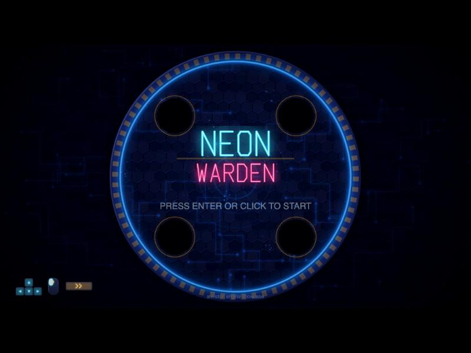
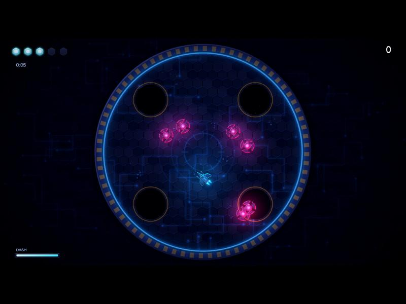

<p align="center"></p>

# Piston

A native macOS editor for making 2D games, with its own web engine. Build a game in the editor, press Play, and ship it as a static website. The editor is SwiftUI; the engine is plain JavaScript on Canvas2D, and it is bundled inside the app, never copied into your project.

**[▶ Play the demo: Neon Warden](https://jurikiin.github.io/piston/play/)**

<p align="center">
  
  
</p>

*Neon Warden* is a one-level arena shooter with a segmented boss, made entirely with Piston. All of its sprites and sound are generated by scripts in `Tools/neon-warden`, with no downloaded assets. Move with WASD, aim and fire with the mouse, dash with Space.

## What's in the box

- **Editor:** scene view and game view, hierarchy, inspector, play/pause/step, console, a code editor, a sprite painter, a timeline animation editor and in-app docs.
- **Engine:** entities and components, 2D physics with joints and rope chains, particles, trails, beams, lights and post-processing (bloom, vignette, grading), audio, animation, scene flow. A fixed-timestep simulation keeps physics independent of the display's refresh rate.
- **Plugins:** extend the editor from JavaScript (permissions are declared and approved per plugin).
- **Builds:** a development build for quick testing, or a release build that bundles, minifies and obfuscates your game into one file. Every release opens with a short *Made with Piston* splash.
- **Samples:** *Mini Golf* (nine holes, menus, scorecard) and *Neon Warden*.

## Requirements

macOS with Xcode's command line tools (Swift) to build the app. The release toolchain in `Toolchain/` includes an arm64 build of esbuild, so release builds need an Apple Silicon Mac; I have only tested on one.

## Build and run

```bash
./bundle.sh               # builds Piston.app (engine, templates, samples and icon inside)
open Piston.app           # lands on the Hub: New Project, Open Project, or open a sample
```

Try a sample from the Hub, or build one from the command line:

```bash
./Piston.app/Contents/MacOS/Piston --build Samples/NeonWarden             # development build into Samples/NeonWarden/dist/web
./Piston.app/Contents/MacOS/Piston --build Samples/NeonWarden --release   # bundled, minified, obfuscated
./Piston.app/Contents/MacOS/Piston --serve Samples/NeonWarden/dist/web    # prints a local URL
```

The editor has automated checks: `Piston.app/Contents/MacOS/Piston --selftest` (needs an unlocked, awake display), and the engine has Node tests in `Engine/web/tests` (`node Engine/web/tests/<file>.test.mjs`).

## Layout

```
Sources/Piston/    the editor (SwiftUI)
Engine/web/        the web engine; ships inside the app, never copied into a project
Bridge/web/        the editor ⟷ runtime bridge pages (Scene view and Game view)
Templates/         what New Project copies, and the exported-page template
Samples/           Mini Golf and Neon Warden, complete projects
EditorDocs/        the in-editor guides (also readable here)
Plugins/           built-in plugins
Tools/             generators for the icon, the Hub art and the sample assets
docs/              design notes, the build pipeline, and the Neon Warden showcase write-ups
docs/play/         the playable web build of Neon Warden (served by GitHub Pages)
```

A **project** is just your game: `project.piston.json`, `scenes/`, `scripts/`, `assets/`, `prefabs/`. Scripts import the engine as `@piston/…`.

Start with [EditorDocs/01-getting-started.md](EditorDocs/01-getting-started.md). How the demo was built, what the engine measured under load and what is still missing are in [docs/showcase/neon-warden](docs/showcase/neon-warden).

## Status

Piston 1.0.0 is a personal project that works end to end but is young. Not yet built: soft bodies, a texture atlas, a WebGL renderer, Android and iOS runtimes. Expect rough edges and open an issue if you hit one.

## License

[MIT](LICENSE) © 2026 Juri Kiin. The vendored build tools in `Toolchain/` keep their own licenses (see `Toolchain/licenses`).
